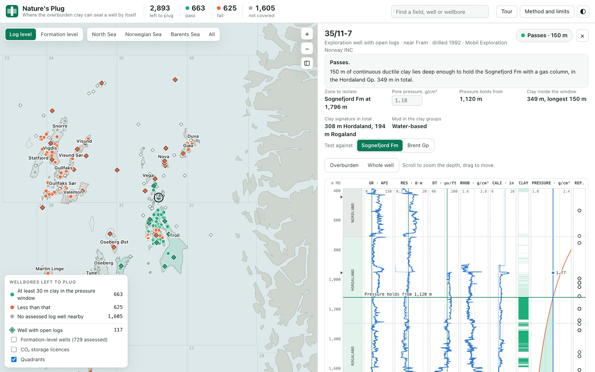
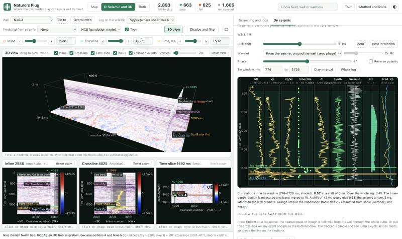

# Nature's Plug

An open atlas of where the overburden clay on the Norwegian continental shelf can seal a well by itself, and where it cannot.



About 2,900 wellbores on the Norwegian shelf are not yet permanently plugged, and plugging is more than half the cost of shutting a field down. Some clays above the reservoir creep in around the casing and close the annulus without cement. Operators have used this as a well barrier element since 2006, but there is no open map of where it can work.

Nature's Plug screens open data for it: well logs from 117 wells, leak-off tests and formation tops from FactPages, and 2.75 million pages of well reports from Diskos. **It ranks where to look. It does not verify a barrier.**

## Run it

No build step and no dependencies. Serve the folder and open it. It is one app on one page: the map and the seismic share the middle of the page, the panel on the right always describes the selected well, and a well chosen anywhere is the same well everywhere.

```bash
python3 -m http.server 8000
```

Then go to <http://localhost:8000>. It works offline. The folder can also be published as it is on GitHub Pages.

The seismic part also needs its Python back end and the seismic cubes, which sit on a separate Linux machine and are not in this repository. `./start.sh` starts the back end there and forwards it; the app is then at <http://127.0.0.1:8777>. `./start.sh local` is the same as the command above. Without the back end everything works except the seismic, and the seismic stage says what is missing.

## What you can do

- **Map.** Every wellbore left to plug, coloured by what the nearest assessed well says. Click a field, a wellbore or a well. The outlines of the open seismic cubes are on the map; click one to open it.
- **Three levels on the same map.** Log level uses the wells with open logs. Formation level runs the same pressure test on 729 exploration wells using formation tops only. Green Clay colours every well by the predicted depth to the top of the Green Clay and marks the report sites it was learned from.
- **Map, seismic or both.** The switch in the top bar puts the seismic sections and the 3D view where the map is, or both above each other. The selected well stays selected.
- **One panel for the selected well.** Screening verdict, logs, the predicted Green Clay interval and report quotes; and for the wells inside a seismic cube a second tab, **On seismic**, with the well tie, the followed events and the thickness map.
- **Well panel.** Gamma ray, resistivity, sonic, density and caliper against depth, the clay signature, and the pressure the barrier must hold against what the leak-off tests give. Scroll to zoom the depth.
- **Report quotes.** Keyword matches from the well's own reports, with file and page. Click a quote to find its depth in the logs.
- **Assumptions.** Every threshold is a slider and the map is recalculated at once. Each well takes a measured pore pressure.
- **Validation.** Does the screen find the fields where the method is already in use?
- **Tour.** A six-step walk-through for a four-minute demo. Arrow keys move between steps.
- **Links.** `#well=35/11-7`, `#wellbore=7/12-A-7 D`, `#field=TROLL` open a selection directly; `#well=Nini-4` and `#well=Nini-5` open the two wells outside the atlas.

## How the screen works

1. **Rock.** A 1 m sample has the clay signature when deep resistivity is below 1.3 Ω·m, gamma ray is above 40 API and sonic is slower than 135 µs/ft. It counts in any group above the reservoir.
2. **Pressure.** At that depth the leak-off tests must give more than the reservoir pressure with a gas column up to it (Williams et al., SPE/IADC 119321, 2009). Pore pressure is the mud weight at the top of the shallowest named hydrocarbon zone, minus 0.05 g/cm³.
3. **Length.** Rock and pressure must hold together over at least 30 m along the hole.
4. **Reach.** A wellbore that is left to plug inherits the result of the nearest assessed well within 10 km.

All of it lives in [`js/engine.js`](js/engine.js), about 280 lines with no DOM code, and is covered by [`tests/engine.test.mjs`](tests/engine.test.mjs).

## Numbers with the default assumptions

Print them with `npm run summary`.

| | Wellbores left to plug |
|---|---:|
| Total (FactPages, 17 November 2026) | 2,893 |
| Near a log well that passes | 663 |
| Near a log well that fails | 625 |
| No assessed log well within 10 km | 1,605 |
| Formation level: clay group inside the pressure window | 1,631 |
| Formation level: less than 50 m in the window | 77 |
| Formation level: clay group above the window | 1,007 |
| Formation level: no assessed well within 10 km | 178 |

52 of the 117 log wells can be assessed; 21 pass, 20 of them on an interval in the Hordaland or Rogaland Group and one, 35/11-15 S, on an interval in the Shetland Group. Counting only the two clay groups would give 652 wellbores instead of 663. 16 fields have at least one wellbore near a passing well, among them Troll, Grane, Johan Sverdrup, Balder and Brage. Gullfaks, Snorre and Visund fail: the clay is there, but it lies above the depth where the pressure holds.

## Green Clay predictor

Built during the hackathon, on 19 November 2026. It is the **Green Clay** level of the map; every well card shows the predicted interval, and **How it was made and tested** in the legend opens the evidence: the charts, the answer key and the documented cases.

Operators on Troll, Oseberg, Brage and Visund call a swelling Eocene clay in the Hordaland Group the Green Clay, and they write its depth in their drilling and completion reports. The predictor uses those sentences as an answer key.

1. A search through the 2.75 million report pages finds 2,098 mentions of the Green Clay in 485 wellbores.
2. Where a report gives the top as a true vertical depth, the number is kept with its file, page and quote: 89 wellbores, which share 29 sites in 7 fields.
3. Each site is compared with the Hordaland and Rogaland Group tops in the nearest vertical exploration well (FactPages).
4. One line is fitted: the Green Clay reaches down to the Rogaland top, and its thickness is 194 m plus 0.14 times the thickness of the Hordaland Group, kept within the 141 to 430 m the sites cover.

| Way to predict the top | Average miss, whole field left out |
|---|---|
| This model | 55 m |
| Copy the thickness from the nearest known site | 72 m |
| Fixed height above the Rogaland top (310 m) | 75 m |
| Plain guess: the middle of the Hordaland Group | 123 m |

Nine in ten held-out sites fall within 106 m. In 100 of 103 log wells the predicted interval has lower resistivity than the same thickness above it, which fits a water-rich clay but does not prove it. Of the 2,893 wellbores left to plug, 844 lie within 10 km of a wellbore whose report names the Green Clay, 1,957 get a prediction from the model alone and 92 have no reference well within 10 km.

What to keep in mind: the answer key is small and all of it is in the northern North Sea. The depths were read by pattern from scanned text; the quote behind every site was read once and two errors were removed, but nobody has checked them against the original pages, and a few are planned depths. The base is assumed to be the Rogaland top. Outside the seven fields the model is untested.

Rebuild it with the three scripts in [`pipeline/greenclay/`](pipeline/greenclay/); `gc_picks.csv` there is the answer key.

### Independent check with a teammate's report reader

At 39 sites at least 2 km from the nearest training site, the Green Clay model and the midpoint of the Hordaland Group did equally well per site. Their mean absolute errors were **51.5 m and 52.2 m**, compared with **79.5 m** for a fixed height of 310 m. These sites used 13 reference wells. Of the 39 sites, 38 were on Troll and one on Oseberg Sør. All were within 10 km of training. The model placed the top 36.6 m too shallow in the independent group and 35.4 m too shallow across all new sites on average, compared with a bias of +4.2 m when whole training fields were left out. Green Clay tops read with Fredric Hegland's report reader (frheg/hackathon-force). [Original reader](https://github.com/frheg/hackathon-force/blob/e923fb230e824ca9ed63aa00d906fa2087c397e8/app/sketches/greenclay.py) · [Results and source cells](pipeline/greenclay/completion_reports/result.json)

<details>
<summary>Reference wells, fields and report checks</summary>

The 58 new sites used 21 reference wells and included 50 sites on Troll. The 19 sites under 2 km are in the same platform or well-template areas as training sites. A further 10 sites shared an exact training-site key and are excluded from both groups below.

| Sites given equal weight within each reference well, then wells given equal weight | Sites | Reference wells | Model MAE | Fixed height MAE | Midpoint MAE |
|---|---:|---:|---:|---:|---:|
| All new sites | 58 | 21 | 55.9 m | 81.2 m | 94.5 m |
| Independent check, at least 2 km | 39 | 13 | 55.0 m | 84.9 m | 66.1 m |

Resampling the 13 reference wells together with their sites (2,000 draws, seed 20261120) gives a 90% interval of **41.2–65.2 m** for the independent per-site model MAE and **−12.0 to +7.0 m** for model minus midpoint. A broader extraction, run separately as a cross-check, gave the model and midpoint 55.3 m each and fixed height 87.8 m across 57 sites at least 2 km from training.

| Field, all new sites | Sites | Wellbores | Model MAE | Fixed height MAE | Midpoint MAE |
|---|---:|---:|---:|---:|---:|
| Troll | 50 | 64 | 49.6 m | 80.9 m | 45.4 m |
| Brage | 3 | 7 | 54.2 m | 49.5 m | 170.0 m |
| Oseberg | 2 | 5 | 51.3 m | 56.1 m | 242.9 m |
| Oseberg Øst | 2 | 7 | 65.9 m | 37.6 m | 242.1 m |
| Oseberg Sør | 1 | 2 | 57.5 m | 25.0 m | 244.5 m |

We checked table headers for actual vertical depth from the rig floor. The retained templates agreed within 5 m in 29 of 30 readable calibration wellbores out of 56 with markers. All 25 randomly drawn readings matched their OCR pages. The largest model error was 143.7 m. A separate review of that broader sample confirmed 29 of 30 readings, finding one prognosis in exploration well 31/4-10. Columns with times, forecasts and depth below sea level can sit beside the actual RKB depth.

Final tops tables are a better source for some training labels. The key has 1,681.7 m for 30/9-F-5 and F-5 A, while the final F-5 A table gives 2,718 m MD and 1,736.9 m TVD RKB. This accounts for both misses in the three-well `actual_rkb` calibration. For 30/6-E-1 the drilling programme gives 1,667 m and the final table 1,657 m. For 31/2-L-13 H the mud log gives 938.4 m and the final table 932.0 m. For 31/5-J-41 the MWD report gives 790 m and the final table 817 m below sea level (840 m TVD RKB). [Reproduce the check](pipeline/greenclay/completion_reports/README.md)

</details>

### Where clay was used as a barrier, and where it did not hold

The same page lists 15 wells from the public reports, read by hand from a keyword search (`pipeline/barrier/`): 7 where clay was used as a barrier or confirmed on a log, 2 where it did not hold and 6 where it was planned and the result is not public. Five of them name the Green Clay. It is reported as a barrier element on Veslefrikk (30/3-A-20 A) and confirmed on a log on Brage (31/4-A-32 A). On Visund (34/8-A-2 H), 792 m of it behind uncemented casing was assumed to have closed in after two years, and total mud losses showed that it had not.

Against these cases the atlas is cautious. For both wells where the clay did not hold it says fail and absent. Of the 7 where it held, the log level has a verdict for 5 and says pass for 1, and the formation level has a verdict for 6 and says present for 2. One reason is that the atlas tests the clay against the pressure of the main reservoir, while several of these wells used it against a shallower zone or used the Shetland Group. The list is short and skewed: plugging reports are rare in the open archive.

## What it has been checked against

Open data has no bond logs, so the screen cannot be compared with verified barriers. Three weaker checks are possible:

- **Fields with documented use.** Havtil's 2025 knowledge report names five fields with wells left where creeping shale is used: Ekofisk, Valhall, Ula, Ivar Aasen and Balder. At formation level all five come out with the clay group inside the pressure window (Valhall for 72 of 105 wellbores, the others for all). The screen was not told which fields they are.
- **The two levels against each other.** Of the wells that have both, 20 of 21 that pass on logs are also flagged by formation tops. So are 8 of the 31 that fail, which is why the logs are needed.
- **The reports.** Clay-specific terms (gumbo, swelling, plastic or mobile clay, creep) are about twice as frequent per kilometre drilled in the Nordland, Hordaland and Rogaland groups as in deeper groups. Plain tight-hole and overpull mentions do not single those groups out.

## Seismic and 3D: wells on seismic

Built during the hackathon, on 19 November 2026. It is the **Seismic and 3D** side of the stage (the switch in the top bar, **On seismic** in a well card, or a click on a cube outline on the map). Choosing a well anywhere moves the seismic to it, and to its cube if another one is shown. It shows a 3D seismic cube as an inline, a crossline and a time slice, linked by cross-hairs, with band-pass filtering, an amplitude spectrum, RMS amplitude, envelope, instantaneous frequency and simple spectral decomposition. The work is done by the back end in [`seismic/server/`](seismic/server/README.md) (numpy and scipy).

- **3D view.** The three sections as planes in one scene, with the wells, their tops and the followed events as surfaces. Drag to turn, wheel to zoom, click a plane to move the cross-hair. Plain WebGL, no library.
- **Logs and tops on the sections.** Gamma ray, sonic velocity, impedance, resistivity or density along the well, the group tops from FactPages and the top of the Green Clay from the predictor, all in two-way time.
- **Well tie.** A synthetic seismogram from sonic and density beside the seismic trace at the well. Wavelet (Ricker, or one with the spectrum of the seismic), phase, polarity, bulk shift and the window the tie is judged in can all be changed, and a track shows the correlation in a sliding 200 ms window, so it is visible where the tie holds.
- **What if at a well.** Under the tie: change the rock in one interval and see whether the trace could tell, against what the tie leaves unexplained (see below).
- **Follow the clay away from the well.** One press follows the event at a top through the whole cube. Two followed events give a thickness map, and each followed event is compared with the same top in the other wells.
- **Logs predicted from seismic.** P velocity, impedance and gamma ray as colour on the inline through a well, with a blind test at every well (see below for how well it works).

The cubes are TNE01 (Troll East) and GN1101 (Smeaheia) from the Smeaheia dataset of Gassnova and Equinor, the 1994 baseline survey of Sleipner (full stack, 94p07) from the Sleipner 4D dataset of the Sleipner Group, and a box of the Danish survey NODAB-97 around the wells Nini-4 and Nini-5, from the free data of GEUS. Atlas wells inside them: 31/3-3 and 31/3-4 in TNE01, 32/2-1 and 32/4-1 in GN1101, 15/9-13 at Sleipner. The two Nini wells are Danish and not in the atlas; they have their own section below. The tie window never starts more than 60 ms above the first sonic sample.

**The one well with a measured time-depth relation.** 15/9-13 comes with a checkshot-corrected sonic log (curve DT-CKS of the Sleipner reference dataset) from sea level to 2000 m. Integrated as it is, with nothing picked or fitted, it puts the sea bed at 109 ms where the seismic shows it at 110 ms. The best bulk shift over the whole log is 0 ms, with normal polarity. The correlation is 0.56 between 800 and 1300 ms, across the Utsira Formation and the top of the Hordaland Group at 1176 ms, 0.29 over the whole log, and 0.12 inside the Hordaland clay below (1116 to 1988 ms). So with the time-depth relation right, the top of the clay ties and the inside of the clay does not: it has little reflectivity of its own to tie to.

**How the time-depth relation is built for the other four wells.** No measured checkshot table is open for them. The sea bed is picked on the seismic, the sonic log is integrated below it, and the unlogged interval between the sea bed and the first usable sonic sample gets one velocity. For 32/2-1 and 32/4-1 that velocity is the one that makes the curve pass through four depth-time picks per well from the dataset's feasibility study (1884 and 1599 m/s). The TNE01 wells have no such picks and use the 32/2-1 value. Sonic that records the steel casing (about 57 us/ft) is removed: in 32/4-1 that is the log down to 727 m. The "OWT" curve delivered with the 32/2-1 logs is not used; it gives the sediments above the first sonic sample the velocity of water and is about 50 ms late below them.

**Where the ties stand** (Ricker 25 Hz, the bulk shift between -40 and +40 ms that correlates best in the tie window, which is the clay interval where the well has one):

| Well | Time-depth | Tie window | Shift | Correlation in the window | Without the shift |
|---|---|---|---|---|---|
| 15/9-13 | checkshot-corrected sonic | 800 to 1300 ms (set by hand) | none | 0.56 | 0.56 |
| 32/2-1 | tied to picks | 646 to 1254 ms (whole log) | +10 ms | 0.54 | -0.16 |
| 32/4-1 | tied to picks | 870 to 1067 ms | +18 ms | 0.64 | -0.50 |
| 31/3-3 | not calibrated | 592 to 1011 ms | +20 ms | 0.37 | -0.22 |
| 31/3-4 | not calibrated | 1169 to 1578 ms | +32 ms | 0.50 | -0.06 |

What to keep in mind:

- **The four fitted shifts are all positive**, 10 to 32 ms, while the well with a measured time-depth relation needs none. One reading is that the four curves are still too fast between the sea bed and the first sonic sample; another is a wavelet that is not zero phase in those two surveys. Neither has been shown.
- **A shift chosen by correlation can sit on the wrong cycle.** The correlation is negative without the shift for every well, so a polarity reversal at no shift scores almost as well. The panel shows both numbers.
- **One independent check exists and it is not good.** The dataset's own Top Shetland horizon is at 968 ms at 32/4-1; the tied time-depth curve puts that top at 989 ms before the shift.
- **Over a whole log the correlation is low** (0.10 to 0.54), because the misfit drifts with depth where nothing calibrates it. The ties hold over a few hundred milliseconds, not over a well.
- **Density is partly estimated from sonic** (Gardner) and marked in the panel.
- **The follower is a plain autotracker.** It can jump a cycle across faults and unconformities, and its result depends on which cycle the seed lands on: the top of the Rogaland Group followed from 31/3-3 came out 8 ms above the same top in 31/3-4 with the first time-depth curves, and 30 ms below it with the present ones; the Shetland top comes out 39 ms above. Two blind checks in one cube, both within a cycle or two, neither a hit. Its lines are a guide to check on the sections, not an interpretation.
- **A strong continuous event is not necessarily the clay.** A published study of the Troll area maps a silica-diagenesis reflector inside the Hordaland Group (Wrona et al. 2017).
- No report-quoted Green Clay depth lies inside either cube, so the Green Clay line is the predictor's estimate, not an observation.
- At 31/3-4 FactPages lists no Hordaland Group but 444 m with "no formal name" under the Utsira Formation. The event followed from the Hordaland top in 31/3-3 continues to that well. Whether it is the same clay has not been checked.

### Nini-4 and Nini-5: the Eocene clay with shear logs, measured ties and measured smectite



None of the five Norwegian wells above has a shear sonic log, a measured time-depth relation and mineralogy together. Two Danish wells have them in the open data of GEUS: Nini-4 (2002, Nini West, the field studied as a CO2 store in Project Greensand) and Nini-5 (2007, Nini East, 12 km away). Both have a shear log and a vertical seismic profile, and Nini-4 also has smectite measured on samples. They are in the app as wells outside the atlas: on the map, in the search and as `#well=Nini-4` and `#well=Nini-5`. They are not screened. What they show is the Horda Formation, the Eocene clay at the base of the Hordaland Group, which the operator's report describes as pale greenish grey claystone. Whether that is the same clay as the Green Clay at any Norwegian field is not shown here.

- **Seismic.** The released final migration of NODAB-97 is 2.2 million traces with an irregular outline, IBM floats, whole-metre coordinates and the line and CDP numbers in header bytes 181 and 21. Three lines are stored twice, with identical samples. `seismic/server/crop_segy.py` cuts a regular box out of it: 501 lines by 1101 CDPs (6.3 by 13.8 km) that holds both wells, 0 to 2400 ms at 4 ms.
- **Time-depth.** The rig-source vertical seismic profile of each well: 58 measured levels from 320 to 1880 m in Nini-4, 68 from 200 to 1830 m in Nini-5. Nothing is picked on the seismic and nothing is shifted.
- **Tops.** The operator's, from the final well reports in the same GEUS packages. The reports are scans, read by OCR and checked against themselves: measured depth minus depth below sea level gives the kelly bushing height in every row. The top of the Horda Formation is at 1701.8 m in Nini-4 and 1617 m in Nini-5, and the formation is 83 m and 43 m thick. The largest gamma-ray step within 15 m of those tops sits at 1702.3 m and 1617.0 m. The reports also print a two-way time beside each top, and the time-depth relations used here give the same times to within 1.5 ms. The one exception is the Frigg Sand in Nini-4 (8 ms), where the printed time does not fit its own neighbours.
- **Tie at Nini-4.** With no shift the synthetic correlates 0.52 with the seismic between 774 and 1726 ms (from the first sonic sample to below the Rogaland top) and 0.45 over the whole log. A shift of +2 ms would give 0.58. That is with the zero-phase wavelet that has the spectrum of the seismic; the survey was spectrally whitened, and a 25 Hz Ricker gives 0.15.
- **Tie at Nini-5.** With no shift the correlation is -0.15 (756 to 1608 ms). A shift of +6 ms gives 0.40, and between 1100 and 1350 ms it is -0.68 without a shift against 0.80 at +8 ms. The seismic arrives about 6 ms later than this well's profile predicts, against 2 ms at Nini-4. The app does not move a measured relation; the panel says what a shift would give.
- **Polarity: the data contradict the documents.** The textual header of the SEG-Y file and section 5.4.1 of the processing report both say that a negative number is an increase in acoustic impedance. The sea bed, which is certain to be an increase, is a positive number in 96 % of 5,661 traces of the box, at 76 ms, where 59 m of water puts it at 80 ms. With the documented polarity the unshifted tie at Nini-4 is -0.52, and it becomes +0.58 only if the synthetic is moved 6 ms earlier. The app therefore uses the polarity of the sea bed and says so in the panel, where the box **Reverse polarity** shows the documented convention. Why the released file and its documents disagree has not been found out.
- **The same contrast in both wells.** Medians of the 100 m above the top of the Horda Formation against the Horda clay below it:

  | | Nini-4 above | Nini-4 Horda clay | Nini-5 above | Nini-5 Horda clay |
  |---|---|---|---|---|
  | Gamma ray, API | 97 | 57 | 90 | 49 |
  | P velocity, m/s | 2435 | 2244 | 2473 | 2206 |
  | S velocity, m/s | 1008 | 829 | 1066 | 833 |
  | Vp/Vs | 2.43 | 2.70 | 2.32 | 2.66 |
  | Density, g/cm3 | 2.29 | 2.16 | 2.28 | 2.13 |

- **Smectite on samples, Nini-4 only** (X-ray diffraction, GEUS Report 2022/31): 0 to 3 % in 34 samples of the Nordland Group, the Nolde sand and the Lark Formation above 1680 m, 14 % in the sample from 1690 to 1700 m, 26 to 54 % in 8 samples of the Horda Formation between 1707 and 1762 m, and 0 to 6 % in two cores below. The tie panel has a Vp/Vs track and a smectite track beside the synthetic.

What to keep in mind:

- **Two wells, and samples from one of them.** They show the contrast at two places 12 km apart. Nothing is learned from them beyond the blind test below.
- **The two ties disagree by 4 ms**, and with a wavelet this broad that is enough to turn the correlation at Nini-5 negative. A few milliseconds between a vertical seismic profile and a surface survey is ordinary; it has not been explained here.
- **The formation names of the samples are the report's**, which follows a later lithostratigraphy than the operator's tops: it divides the clay above the Horda Formation into units of the Lark Formation, and its two deepest cores, called Sele there, lie in the operator's Lista and Vile formations.
- **Cuttings are depth intervals**, 3 to 20 m long, and mix what was drilled in them. Two of the eight Horda samples are cores.
- **The Horda Formation is thin here**, 83 m and 43 m including a sand at its base in Nini-4, far less than the hundreds of metres of clay screened in the Norwegian wells.
- **High Vp/Vs and smectite are not ductility.** No deformation test of this clay is part of this. The rock-mechanics tests published for Nini-5 (SINTEF 2009, GEUS file 35990) were made on Sele shale below it.
- **The table of smectite values is not in this repository.** The report states no licence, and the journal article on the same samples (Petersen et al. 2022, doi 10.1016/j.ijggc.2022.103675) is not open access. `seismic/server/prep_nini.py` reads the values from the published spreadsheet and they stay with the seismic back end. The ranges above are cited from the report.

### Logs predicted from seismic, and how well that works

`seismic/server/predict_logs.py` predicts P velocity, acoustic impedance, gamma ray and, where a shear log exists to learn from, Vp/Vs away from the wells, and the app draws the result as colour on the inline through a well (**Predicted from seismic** in the side panel) and as a blind curve beside the log in the well-tie panel. The inline is turned into features on a grid of 16 ms by 16 traces, the logs smoothed to 32 ms are the answer key at the well trace, and a ridge regression connects the two. Three sets of features are compared: two-way time below the sea bed alone (the compaction trend, no seismic), time plus classic attributes (relative impedance, envelope, RMS amplitude, instantaneous frequency), and time plus the patch embeddings of the NCS seismic foundation model ([Ordoñez et al. 2026](https://arxiv.org/abs/2603.23211); `NorskRegnesentralSTI/NCS-v1-2d-base`, Apache-2.0, frozen and not fine-tuned, 12 principal components).

The test is leave-one-well-out over the seven wells in the four cubes: the model never sees the well it is scored on. Mean over the wells, with the full table in [`data/log_prediction.json`](data/log_prediction.json):

| Property | Time trend only | + classic attributes | + NCS embeddings |
|---|---|---|---|
| P velocity, 7 wells: correlation, error | 0.74, 492 m/s | 0.67, 505 m/s | 0.70, 547 m/s |
| Acoustic impedance, 7 wells: correlation, error | 0.74, 1493 | 0.64, 1485 | 0.66, 1538 |
| Gamma ray, 7 wells: correlation, error | 0.44, 29.3 API | 0.23, 31.4 API | 0.40, 31.1 API |
| Vp/Vs, 2 wells: correlation, error | 0.57, 0.155 | 0.48, 0.160 | 0.36, 0.253 |

What that says:

- **For velocity and impedance the seismic adds nothing on average.** The depth trend alone has the lowest mean error for velocity and is level with the attributes for impedance. Well by well it is mixed: the classic attributes lower the velocity error in 4 of the 7 wells and the impedance error in 5, most clearly at Nini-4 (188 to 147 m/s). The NCS embeddings lower the velocity error in 2 of 7.
- **For gamma ray nothing predicts well.** The NCS embeddings carry a weak signal: of what the trend misses, their part correlates 0.18 on average (-0.20 to 0.54 over the wells; -0.07 for the classic attributes). They lower the error in 4 of 7 wells and not on average.
- **Vp/Vs is not predicted.** Three wells have a shear log and only the two Danish ones have enough of it on this grid to be scored, so each is predicted with the other left to learn from. The trend alone gives an error of 0.155, the attributes 0.160 and the NCS embeddings 0.253. The contrast to find at the top of the Horda Formation is about 0.3.
- **Seven wells in four areas is very little to learn from.** The areas span about 470 km from north to south, the logs are of different vintages, gamma ray is not calibrated between them, and four of the seven wells are placed in time by a fitted shift.
- **The grid is coarse**: nothing finer than about 30 ms can come out, so thin beds are out of reach. The Horda Formation at the two Danish wells is about 75 and 40 ms thick.
- Ductility and smectite content are not predicted: no well has a deformation test of the clay, and smectite is measured in one well.

So the tool is there, and with the open data it does not yet predict logs better than a depth trend. That is a result about the data, not a tuned model: nothing was fitted to make the table look better.

Rebuild: `seismic/server/prep.py` converts a SEG-Y cube, `seismic/server/prep_wells.py` places the wells and writes `wells.json` beside the cube and `data/seismic_wells.json` for the atlas. For a survey that is not a regular grid, `seismic/server/crop_segy.py` first cuts a regular box out of it. `seismic/server/prep_nini.py` reads Nini-4 and Nini-5 from the GEUS files into a well file that `prep_wells.py --extra` takes.

### What if at a well

Under the tie plot is a small scenario tool, added on 19 November 2026. An assessment of forward modelling for this project concluded that this is the one piece worth building. It answers one question: if the rock in one interval of this well were different, could the seismic trace at the well tell? It is a calculation from the logs of one well. It is not a detector of ductile clay, and it never changes the tie.

- **The interval** runs from the predicted Green Clay top (or the Horda Formation) down to the Rogaland top. Both ends can be moved to another top or to a depth.
- **The change.** Scale P velocity (−20 to +20 %) and density (−10 to +10 %), or choose **Like the layer above**. That choice mirrors the logged samples above the top into the interval, folded back and forth where the interval is thicker than the log above it. It does not multiply the interval by a number: that would keep the interval's own layering and can leave a false step at its top. Put the top on the step in the log itself, because a step just above the top is mirrored into the interval. With less than 20 m or 10 samples of unbroken log above the top the choice is switched off, and the panel says why.
- **Scenario controls.** Change only the uppermost metres, let the change come in gradually over up to 60 m, or add one hard streak of 2 to 10 m (velocity and density up by the same factor).
- **Time.** A change in velocity moves everything below it by 2 × thickness × (1/new velocity − 1/old velocity). The changed log is put back on the 2 ms grid, and the delay is shown with the velocity of the interval before and after, so the sign is explained: the rock above can be slower than the interval, and then everything below arrives later, not earlier.
- **The misfit band.** The synthetic as logged is scaled to the seismic trace by least squares inside the tie window, at the current shift. The typical size (RMS) of what the seismic has left, divided by that scale, is the band: what the tie leaves unexplained, in the units of the synthetic. The band follows from the correlation alone (√(1 − r²)/r times the synthetic), so it is shown with a range: the same number with the correlation one standard error down and up. In a simulation with tie-length windows the true band lay inside that range about two times in three.
- **The chance check.** A shift chosen as the best between −40 and +40 ms finds some correlation on any trace. So the synthetic is also laid on the same trace at wrong times (every 100 ms, 200 ms or more away) and searched the same way. If more than one wrong place in twenty scores as high as the tie, the panel says the tie is no better than chance. The band is then only a lower bound, and no change is read as larger.
- **The reading.** For the top, the base, a hard streak and the 300 ms below the interval the panel gives the typical size of the change divided by the band. Larger than what the tie leaves unexplained only if the change beats the wide end of the band; smaller (this trace cannot tell the two apart) only if it stays under the narrow end; undecided in between. The same numbers are given with the wavelet phase turned 30° either way, and a reading that flips there is not a firm one. The plot shows the synthetic as logged, the scenario and their difference, with a box for the typical size in every window beside the amber band. Single peaks stand higher than the typical size, so a peak outside the band is not by itself a larger reading. The correlation of both synthetics with the seismic is shown as well, in grey and with a rough standard error from the window length and the bandwidth of the wavelet, because a small difference in correlation invites over-reading.

Two examples with the ties the app starts with:

- **Nini-4 (Nini 1997), a tie that holds.** Wavelet from the seismic, measured time–depth relation, no shift, correlation 0.52. None of 11 wrong places reaches that (0.08 in the middle). The band is 1.6 times the synthetic (1.3 to 2.1). Making the Horda Formation (1702 to 1785 m) like the layer above raises the velocity of the interval from 2288 to 2425 m/s, so everything below arrives 4.1 ms earlier. The top reads 0.9 of the band (0.7 to 1.2: undecided), the base 1.5 (1.2 to 1.9: larger). With the phase turned by +30° the base reads 0.7, so even this is not a firm reading. Below the interval nothing can be judged: only 46 ms of log is left.
- **31/3-3 (TNE01), a tie no better than chance.** Ricker 25 Hz, shift +20 ms chosen by correlation, correlation 0.37 (−0.22 without the shift). At 4 of 28 wrong places the same search scores 0.37 or more (0.28 in the middle). The band is at least 2.5 times the synthetic. Making the predicted Green Clay interval (592 to 826 m) like the layer above lowers the velocity of the interval from 1941 to 1818 m/s, because the 104 m of log above it is slower, so everything below arrives 16.4 ms later. The trace changes by 0.1 of the band at the top, 0.8 at the base and 0.4 below: all smaller. With this tie, this trace cannot tell the logged clay from the rock above it. The correlation goes from 0.37 to 0.21, with a rough standard error of 0.18.

What the panel cannot show:

- Whether a clay is ductile or seals. A change in velocity and density is not creep.
- Anything beyond one trace at normal incidence: no offsets, no shear waves, no anisotropy, no multiples, no change away from the well.
- Which part of the band is noise. The band holds everything the tie does not explain: noise, a wrong wavelet, a wrong time–depth relation, logs that do not represent the rock the seismic sees. A better tie narrows it.
- That a change is invisible on a section. "Smaller than the band" is about this trace with this tie; an event followed over many traces can stand out where one trace does not.
- A delay on its own. A bulk shift of the tie absorbs it unless events above the interval hold the tie in place, and it needs events below the interval inside the log (at least 150 ms of log, or the panel gives no reading). The stretch below the interval often lies outside the tie window, and the panel says so when it does.
- That a larger change always gives a larger number. A trace moved by a whole wavelet cycle looks much like itself, so the numbers for the base and below can drop when the delay comes close to a whole cycle. The panel says so when that happens.
- A statistical test. The range of the band is one standard error either way, the chance check has only as many wrong places as the trace has room for (8 to about 30), and layers thinner than the 2 ms log grid (about 2 m) are averaged.

## What it does not do

- It does not verify a barrier. That takes bond logs and a pressure test of the annulus.
- Mud weight overstates pore pressure. Measured formation pressures are in the well reports and should replace it.
- The thresholds are not calibrated against laboratory or field data.
- A wellbore is judged by a neighbouring exploration well, not by its own logs.
- Logs are resampled to 1 m. At the original 0.15 m sampling with strict continuity, 651 wellbores pass instead of 663. The headline is stable; the split between 30 m and 50 m intervals is not.
- Report quotes are keyword matches in scanned text. They are leads to read, not findings.

## Data and licences

| Source | Used for | Licence |
|---|---|---|
| [FORCE 2020 well log and lithofacies dataset](https://zenodo.org/records/4351156) | Well logs; 117 of its 118 wells are used | CC BY 4.0 |
| [FactPages and FactMaps](https://factpages.sodir.no/), Norwegian Offshore Directorate | Wellbores, tops, leak-off tests, mud, field outlines, quadrants | NLOD 2.0 |
| [Diskos report texts](https://zenodo.org/records/10775273), FORCE | Report quotes | CC BY 4.0 |
| [Smeaheia dataset](https://co2datashare.org/dataset/smeaheia-dataset), Gassnova SF and Equinor ASA, CO2 DataShare, doi 10.11582/2021.00012 | Seismic cubes TNE01 and GN1101, logs and time-depth of 32/2-1 and 32/4-1 | [Smeaheia Dataset Licence](https://co2datashare.org/smeaheia-dataset/static/SMEAHEIA%20DATASET%20LICENSE_Gassnova%20and%20Equinor.pdf) (based on CC BY 4.0; may not be sold). Not redistributed here |
| [Sleipner 4D Seismic Dataset](https://co2datashare.org/dataset/sleipner-4d-seismic-dataset) (doi 10.11582/2020.00005) and [Sleipner 2019 Benchmark Model](https://co2datashare.org/dataset/sleipner-2019-benchmark-model) (doi 10.11582/2020.00004), the Sleipner Group, CO2 DataShare | Seismic cube 94p07 (1994 baseline, full stack), logs of 15/9-13 | [Sleipner CO2 Reference Dataset Licence](https://co2datashare.org/sleipner-2019-benchmark-model/static/license.pdf) (based on CC BY 4.0; may not be sold). Not redistributed here |
| [Free Danish subsurface data](https://eng.geus.dk/products-services-facilities/data-and-maps/subsurface-data-denmark), Geological Survey of Denmark and Greenland (GEUS): 3D survey NODAB-97 (CGG 1997 to 1999) and well packages NINI-4 and NINI-5 | Seismic box around Nini-4 and Nini-5; their logs, deviation, vertical seismic profiles and the tops in their final well reports | [GEUS terms for free Danish subsurface data](https://data.geus.dk/ugdata2d3d/terms_20230906.pdf) of 19 September 2023: use and derived products allowed, GEUS to be named as the source. Not redistributed here |
| Schovsbo, Petersen, Weibel and Springer 2023, Upper seal characterisation and capacity evaluation based on cutting analysis of the Nini-4 well, GEUS Report 2022/31, [doi 10.22008/gpub/34666](https://doi.org/10.22008/gpub/34666), Appendix F | Smectite contents and formation labels of the Nini-4 samples | No licence stated. Cited; the values are not in this repository |
| [NCS seismic foundation model](https://github.com/NorskRegnesentral/NCS_models), Norwegian Computing Center (Ordoñez et al. 2026, arXiv:2603.23211) | Features for the log prediction | Apache-2.0. Not redistributed here |
| [Natural Earth](https://www.naturalearthdata.com/) | Land polygons | Public domain |
| Havtil / Reflekt AS, knowledge report on creeping shale as a well barrier element, 25 November 2025 | Fields with documented use | Cited |

The files under `data/` are derived from these sources and keep their licences. The code is MIT licensed.

## Repository layout

```
index.html, css/, js/     the app: one page (vanilla JavaScript modules, canvas map, SVG log tracks)
js/engine.js              the screening logic
js/workspace.js           map and seismic on one stage, one selected well, the tabs of the right panel
js/greenclay.js           the Green Clay level: map colours, well cards and the evidence sheet
data/                     static JSON the app loads (53 MB, most of it loaded on demand)
pipeline/                 scripts that build data/ from the raw downloads
seismic/                  the seismic part of the page (app.js sections, wells.js wells and tie, whatif.js the what-if panel, view3d.js) and seismic/server/, its Python back end (built during the hackathon)
start.sh                  starts the whole app, including the seismic back end on the Linux machine
tests/, tools/            engine and data tests and a command-line summary (Node 20 or newer)
talk/                     the four-minute presentation: eleven slides over a 3D scene, see talk/README.md
```

## Rebuild the data

See [`pipeline/README.md`](pipeline/README.md). In short: download about 6 GB of open data, index the report texts, export. The export is deterministic; running it again gives byte-identical files apart from the build time.

## Tests

```bash
npm test
```

This runs the engine and data tests and `tests/whatif.test.mjs`, the checks of the what-if calculation (zero change, the delay against the formula, no step and no leftover layering for "like the layer above", the gradual top, the hard streak, the misfit band against a known noise level and its range in a window as short as a tie window, the standard error of a correlation against a simulation, the chance check on unrelated and on real ties, the base reading when the change grows, missing log values).

The seismic back end has its own tests (Python 3 with numpy, scipy, Pillow and pytest): `cd seismic/server && python -m pytest -q`.

## Field characterisation

Havtil's 2025 knowledge report on creeping shale (Reflekt AS, 22 November 2025, chapter 11) says there is "most likely a need for a more systematic formation characterization across fields", calls work on geologically similar layers promising for transferring track records (but one that will require consistent geological and geomechanical criteria), and calls for common databases. The app offers a first, open attempt on one narrow set of measures, from public data only (`js/fieldchar.js`, tests in `tests/fieldchar.test.mjs`):

- **The same measures for every field.** Each field card gives six medians over the exploration wells nearest to its wellbores: top of the Hordaland Group below the sea bed, Hordaland and Rogaland thickness, the assumed reservoir pore pressure, the depth below the sea bed from which the leak-off estimate holds the gas, and the clay group inside that window. They are depth, thickness and pressure-window numbers, not creep or mechanical properties.
- **The fields most alike.** The four nearest fields in Hordaland depth and thickness, Rogaland thickness and pore pressure (robust standard units, at least three shared measures), marked where a field has documented use or a reported case. Closeness in these numbers has not been shown to predict how the clay behaves. The southern chalk fields where Havtil documents use (Ekofisk, Valhall, Ula) come out as each other's nearest neighbours.
- **The track record.** Havtil's documented use and the hand-read cases of the field itself; cases of other fields within 10 km are listed as context and never mark the field.
- **An open table.** "Download the field table (CSV, current settings)" in the Validation tab gives one row per field. It is one table from this tool, not a substitute for the common databases the report asks for.

Nothing here changes a headline number.

## What was prepared before the hackathon

The data pipeline, this first version of the app and the slides in [`talk/`](talk/README.md) were prepared on 17 and 18 November 2026, before the FORCE VibeCode Hackathon in Stavanger began, with AI coding assistance (Claude Code). The Green Clay level, the seismic and 3D part and the single-page workspace that holds everything together were built during the hackathon, on 19 November, and the field characterisation, the animated explainer (`talk/explain.html`) and the independent Green Clay check against completion reports (with Fredric Hegland's report reader, run with OpenAI Codex) on 20 November, also with AI assistance. The organisers asked participants to bring data and ideas and to download large data sets in advance. Everything is built from open data only.

## Where it should go next

- Replace the mud-weight estimate with measured formation pressures read from the reports.
- Read cement tops, casing programmes and mud type for the development wells themselves, so each wellbore is judged on its own.
- Calibrate the clay signature against published smectite measurements.
- Let an operator drop in a bond log and compare it with the prediction.
- The same screen applies to legacy wells inside CO₂ storage licences, which the map can already show.
